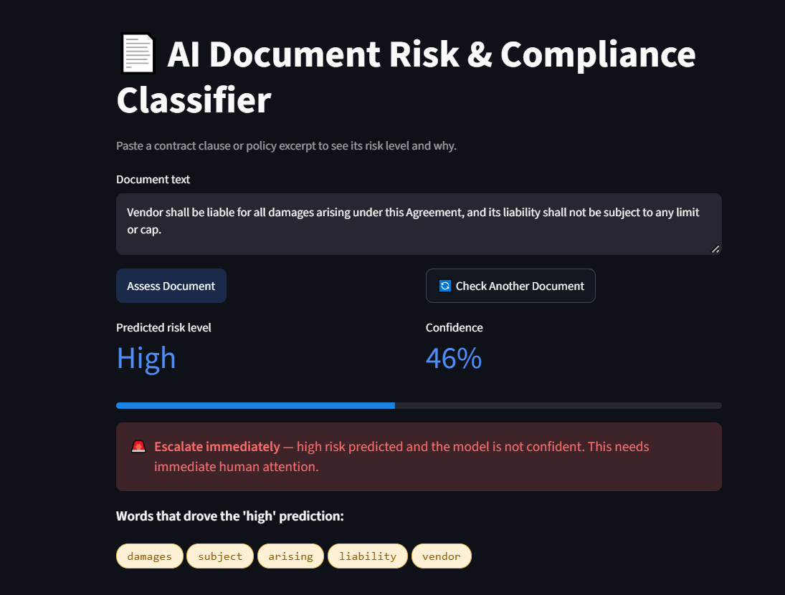

# AI Document Risk & Compliance Classifier

Predicts the **risk level** (low / medium / high) of a contract clause, shows
the words that drove the prediction, and recommends a review action
(Auto-clear / Flag for review / Escalate immediately).



## Features

- TF-IDF (words and 2-word phrases) + Logistic Regression classifier
- Explainability: shows the top words behind each prediction
- Tiered review policy instead of one flat confidence cutoff
- Streamlit dashboard

## Data

Real contract clauses from **CUAD v1** (Contract Understanding Atticus
Dataset, The Atticus Project, CC BY 4.0): 510 commercial contracts with
clauses marked by legal experts in 41 categories.
Source: https://zenodo.org/records/4595826

Each clause category is mapped to a risk level (see
[`RISK_CATEGORIES.md`](RISK_CATEGORIES.md) for the full mapping and reasons):

| Risk | Meaning | Example categories |
|---|---|---|
| High | Large or open-ended legal / financial exposure | Uncapped Liability, Non-Compete, Exclusivity, Change Of Control |
| Medium | Limits flexibility, bounded impact | Audit Rights, Insurance, Anti-Assignment, Renewal Term |
| Low | Descriptive / administrative | Parties, Governing Law, Agreement Date |

`collect_dataset.py` builds `data/real_documents.csv`: 2,400 clauses,
800 per risk level.

## Project structure

```
collect_dataset.py          # collects CUAD clauses and assigns risk levels
train_risk_classifier.py    # trains, evaluates, explains, saves the model
app.py                      # Streamlit dashboard
RISK_CATEGORIES.md          # risk definitions and category mapping
data/real_documents.csv     # collected dataset (2,400 clauses)
models/                     # trained classifier
reports/                    # evaluation, explainability, flagged documents
generate_documents.py       # early synthetic prototype data (not used for the final model)
```

## Run it

```bash
git clone https://github.com/<your-username>/<your-repo>.git
cd <your-repo>
pip install -r requirements.txt
streamlit run app.py
```

To rebuild the data and retrain (download `CUAD_v1.zip` from the Zenodo link
above and extract `CUAD_v1.json` first):

```bash
python collect_dataset.py --json CUAD_v1.json
python train_risk_classifier.py
```

## Results (held-out test set, 480 clauses)

| Metric | Score |
|---|---|
| Accuracy | 82.1% |
| Macro F1 | 0.823 |

| Class | F1 |
|---|---|
| Low | 0.938 |
| High | 0.779 |
| Medium | 0.752 |

Low-risk clauses are easy to spot because they are standard wording.
Most errors are **high vs. medium** (67 of 86 mistakes), because those
clauses use similar legal language.

An earlier prototype used 1,650 synthetic rows built from only 28 unique
sentences and reached 94.8%. That number was inflated by repeated sentences,
so it was replaced with real data.

## Tiered review policy

A missed high-risk clause costs more than a missed low-risk one, so
confidence alone is not enough:

- High risk + low confidence -> **Escalate immediately**
- High risk + high confidence, OR any risk + low confidence -> **Flag for review**
- Low/medium risk + high confidence -> **Auto-clear**

## Limitations

- Risk labels come from the clause **category**, not the exact wording. For
  example, a liability cap of $1 and one of $10 million are both "Cap On
  Liability". The mapping is a proposed policy, not legal advice.
- The model reads words, not meaning, so it can miss negation or context.
- English commercial contracts only.
- Many predictions go to human review (305 of 480). The 0.60 confidence
  threshold could be tuned.

## Next steps

- Use a transformer model (for example, a legal-domain BERT)
- Tune the confidence threshold using the cost of each type of mistake
- Upload PDF or Word files and score them clause by clause
